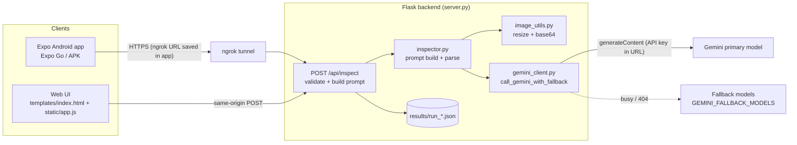

# Amalgamation Inspector — Backend + Mobile App

AI-assisted visual quality inspection. An operator photographs a product, a Flask backend sends the photo to the Google Gemini API, and the result comes back as a **conforming / defective / uncertain** verdict with reasoning. Two clients exist: a browser UI served by the backend, and an Expo / React Native Android app.

> **Scope of this document.** Written from the actual source of `servermobile_C1` (backend + web UI) and the Expo app source (`ai-vision-expomobile v2`, from the `AI-Vision-Engine-main` archive). Anything not verifiable from those files is marked **[unverified]**. No real API keys appear here.

## Contents

1. [Project Overview](#1-project-overview)
2. [Key Features](#2-key-features)
3. [Technology Stack](#3-technology-stack)
4. [System Architecture](#4-system-architecture)
5. [Directory Structure](#5-directory-structure)
6. [Prerequisites](#6-prerequisites)
7. [Installation and Setup](#7-installation-and-setup)
8. [Environment Configuration](#8-environment-configuration)
9. [Running the Application](#9-running-the-application)
10. [API Documentation](#10-api-documentation)
11. [AI Pipeline and Model Details](#11-ai-pipeline-and-model-details)
12. [Model Fallback](#12-model-fallback)
13. [Evaluation, Storage, and Data](#13-evaluation-storage-and-data)
14. [Testing and Validation (Smoke Test and Fallback Test)](#14-testing-and-validation)
15. [Deployment](#15-deployment)
16. [Security and Privacy](#16-security-and-privacy)
17. [Known Limitations and Troubleshooting](#17-known-limitations-and-troubleshooting)
18. [Roadmap](#18-roadmap)
19. [Contributing](#19-contributing)
20. [License](#20-license)
21. [Documentation Audit](#21-documentation-audit)

---

## 1. Project Overview

**Problem.** Visual quality checks (dents, scratches, cracks, damaged door seals, rust) on products such as appliances are manual and inconsistent. This project lets a user name the product, optionally supply known-good reference photos, upload one photo to inspect, and receive a structured verdict.

**Intended users.** Operators and QC staff using the web page on a PC or the Android app in the field.

**How it decides.** There is no trained model in this repository. Each request makes **one** call to the Gemini `generateContent` REST API with a server-built prompt and the images. See [section 11](#11-ai-pipeline-and-model-details).

**Development status (from the code).**

| Part | Status |
|---|---|
| Backend (`/api/inspect`, prompts, parsing, run logging) | Implemented |
| Model fallback (retry + fallback chain) | Implemented; offline-tested (6 cases pass) |
| Web UI (`templates/index.html`, `static/`) | Implemented |
| Expo app: main form, product dropdown, camera/gallery, server-URL settings modal, results screen, JSON save/share | Implemented in source |
| Expo app: dedicated Settings route, APK build, structured device testing, visual polish | Not evidenced in source. The code comment calls the settings modal a "placeholder" |
| Automated test suite (pytest/jest/CI) | None. Only two standalone scripts exist ([section 14](#14-testing-and-validation)) |

No demo link or screenshots exist in the repository.

---

## 2. Key Features

**Implemented**

- Product-name-driven inspection. The server fills a fixed prompt template (`PRODUCT_TASK_TEMPLATE` in `server.py`).
- Two modes: **with reference images** (1 to 5 known-good photos) and **prompt-only** (no references; a stricter prompt that guards against false positives).
- Three verdicts: `conforming`, `defective`, `uncertain`, plus `defect_percentage`, `confidence_score`, `location`, `reasoning`.
- **Product identification.** The model reports what the image actually shows (`detected_product`) and whether it matches the selected product (`product_match`: `true` / `false` / `"unsure"`). On a mismatch, confidence is capped at `0.6` and the finding text is prefixed `PRODUCT MISMATCH:` (or `PRODUCT UNCLEAR:` when unsure).
- **Model fallback.** Retries busy responses (HTTP 429/500/503/504) and then falls back to the next model in `GEMINI_FALLBACK_MODELS`. The run record reports `model_requested` and `model_used`.
- Automatic image downscaling (long edge max 1536 px) before upload.
- Every run saved as `results/run_<timestamp>_<id>.json`, with timing breakdown.
- Web UI: result display, timing details, "Download result JSON".
- Expo app: camera or gallery capture, ngrok URL settings with **Paste** and **Test Connection**, results screen, JSON **Download** (Android folder picker, remembered) and **Share**.

**Partially implemented**

- `extra_notes` (appended to the prompt). Wired end to end; hidden in the web UI (`hidden` CSS class in `index.html`), available behind an "Add additional notes" toggle in the Expo app.
- Mismatch information reaches both UIs **only through the `finding` text prefix**. Neither UI renders `detected_product`, `product_match`, `mismatch_message`, or `model_used` as dedicated fields.

**Planned** — see [section 18](#18-roadmap). Nothing there is implemented.

---

## 3. Technology Stack

| Layer | Technology | Version (source) |
|---|---|---|
| Backend | Python, Flask, flask-cors | Flask 3.0.3, flask-cors 4.0.1 (`requirements.txt`) |
| HTTP to Gemini | `requests` (direct REST, no Google SDK) | 2.32.3 |
| Config | python-dotenv | 1.0.1 |
| Image handling | Pillow | 10.4.0 |
| AI | Google Gemini API, `v1beta/models/<model>:generateContent`, JSON response mode | Model names come from `.env` |
| Web UI | Plain HTML/CSS/JS (no build step) | — |
| Mobile | Expo (`expo-router`), React Native, React, TypeScript | expo `^58.0.19`, react-native `0.88.0`, react `19.3.0` (`package.json`) |
| Mobile libs | async-storage, picker, image-picker, clipboard, file-system, sharing | see `package.json` |
| Tunnel (dev) | ngrok; `@expo/ngrok ^4.1.3` for `expo start --tunnel` | — |

The earlier README said "Expo SDK 57". `package.json` declares Expo 58 packages; trust `package.json`.

---

## 4. System Architecture



**Request flow.** The client posts `multipart/form-data` (product, mode, images). `server.py` validates input and builds the task text. `inspector.py` builds the system prompt and encodes images (`image_utils.py`). `gemini_client.call_gemini_with_fallback` calls Gemini, retrying and falling back as needed. `inspector.parse_inspection_response` validates the JSON, fills safe defaults, and applies mismatch handling. `server.py` writes the run JSON and returns it.

**Not present:** database, authentication, background workers, message queue, model hosting, containers, CI/CD.

---

## 5. Directory Structure

Root of the merged archive:

```
minecurrent/
├── servermobile_C1/            # Flask backend + web UI (this README lives here)
│   ├── server.py               # Flask app, routes, validation, prompt template, run logging
│   ├── inspector.py            # Prompt construction, response parsing, mismatch logic, both modes
│   ├── gemini_client.py        # Gemini REST wrapper + call_gemini_with_fallback()
│   ├── image_utils.py          # Type check, resize (max 1536 px), base64 encode
│   ├── smoke_test.py           # One real Gemini call through the fallback wrapper
│   ├── test_fallback.py        # Offline fallback tests (fake Gemini, no network)
│   ├── requirements.txt
│   ├── .env.example            # Copy to .env
│   ├── .gitignore              # ignores .env, venv/, __pycache__/, results/*.json
│   ├── README_mobile_app.md    # Earlier mobile planning/spec notes (partly outdated)
│   ├── Project README.md       # This file
│   ├── templates/index.html    # Web UI
│   ├── static/                 # app.js, style.css, favicon.svg
│   ├── results/                # Run JSON output (created at startup)
│   └── reference_images/       # Optional local folder; not read by the app
└── expomobile_C1/              # EMPTY in this archive (see note below)
```

> **Important:** `expomobile_C1/` is empty in `minecurrent.zip`. The mobile app source exists in `AI-Vision-Engine-main.zip` as `ai-vision-expomobile v2/`. Copy its contents into `expomobile_C1/` (or keep it as a sibling folder) before following the mobile steps.

Expo app layout (from `ai-vision-expomobile v2`):

```
├── src/app/_layout.tsx     # Stack: index -> results
├── src/app/index.tsx       # Main route: form host, settings modal (server URL), submit
├── src/app/results.tsx     # Result screen, JSON download/share, "New inspection"
├── screens/MainScreen.js   # Form: product dropdown, mode toggle, image pickers
├── lib/api.js              # submitInspection(), testConnection()
├── lib/storage.js          # Server URL in AsyncStorage
├── lib/runStore.ts         # In-memory hand-off of the last run
├── lib/exportResult.ts     # Save / share result JSON
├── .env                    # EXPO_PUBLIC_USE_RN_FETCH=1
├── app.json, package.json, tsconfig.json
└── src/components, src/hooks, src/constants, assets/   # Expo template files
```

---

## 6. Prerequisites

**Mandatory**

| Software | Check |
|---|---|
| Python 3.10+ | `python --version` |
| Google AI Studio API key | https://aistudio.google.com/apikey |
| Internet access to `generativelanguage.googleapis.com` | — |

**For the mobile app**

| Software | Check |
|---|---|
| Node.js 18+ and npm | `node --version`, `npm --version` |
| Expo Go on an Android phone | Play Store |
| ngrok account + CLI (phone must reach the PC backend) | `ngrok version` |

**Optional:** VS Code, Git. No GPU or local model is needed; inference runs on Google's servers.

---

## 7. Installation and Setup

Commands are Windows PowerShell. Replace `<project>` with your folder path.

### 7.1 Backend

```powershell
cd <project>\servermobile_C1
python -m venv .venv
.venv\Scripts\activate.ps1
pip install -r requirements.txt
copy .env.example .env
```

Then edit `.env` and set `GEMINI_API_KEY` ([section 8](#8-environment-configuration)). 

### 7.2 Mobile app

```powershell
cd <project>\expomobile_C1        # or wherever the Expo app folder is
npm install
npx expo install expo-image-picker @react-native-async-storage/async-storage expo-clipboard @react-native-picker/picker
npm install --save-dev @expo/ngrok@^4.1.0
```

`package.json` already lists these packages, so `npm install` alone should suffice. The `expo install` line is kept from the original setup guide and is harmless. Create `.env` in the Expo folder containing exactly:

```
EXPO_PUBLIC_USE_RN_FETCH=1
```

This is required. Without it, image uploads fail with `Unsupported FormDataPart implementation`. The file contains no secrets.

### 7.3 ngrok (once per machine)

Download from ngrok.com/download, then:

```powershell
ngrok config add-authtoken <your-authtoken>
```

---

## 8. Environment Configuration

Backend `.env` (read by `python-dotenv` at startup). Safe template (`.env.example`):

```
# Google AI Studio key: https://aistudio.google.com/apikey
GEMINI_API_KEY=your_key_here

# Primary model
GEMINI_MODEL=gemini-3.6-flash

# Optional comma-separated fallback models, tried in order. Blank = no fallback.
GEMINI_FALLBACK_MODELS=gemini-2.5-flash

# Seconds to wait for one Gemini call (applies per attempt)
GEMINI_TIMEOUT=120

PORT=5000
```

| Variable | Required | Default in code | Notes |
|---|---|---|---|
| `GEMINI_API_KEY` | Yes | empty | If empty, `/api/inspect` returns HTTP 500 with a config message |
| `GEMINI_MODEL` | No | `gemini-2.5-flash` (`server.py`) | `.env.example` sets `gemini-3.6-flash`. **Model availability for your key is [unverified]** |
| `GEMINI_FALLBACK_MODELS` | No | none | Read from the environment on each call |
| `GEMINI_TIMEOUT` | No | `120` | Seconds, per Gemini attempt |
| `PORT` | No | `5000` | Flask listen port |

Mobile: `EXPO_PUBLIC_USE_RN_FETCH=1` (required). The backend URL is **not** an env var; it is saved in the app's Settings.

**Secrets.** `.env` is git-ignored. Never commit it, paste it in chats, or ship it in an archive. Rotate the key if it was ever shared.

---

## 9. Running the Application

Startup order: backend, then tunnel, then mobile app. Web-only use needs only step 1.

**Terminal 1 — backend**

```powershell
cd <project>\servermobile_C1
venv\Scripts\activate
python server.py
```

Expected: `Running on http://127.0.0.1:5000` (and your LAN IP). If you see `WARNING: GEMINI_API_KEY is not set`, fix `.env`. Web UI: http://localhost:5000.

**Terminal 2 — tunnel (mobile only)**

```powershell
ngrok http 5000
```

Copy the `https://...ngrok-free.dev` URL from the `Forwarding` line. A free-tier URL changes on every restart.

Check the tunnel before using the phone:

```powershell
curl.exe -X POST https://<ngrok-url>/api/inspect -F "product=washing machine" -F "mode=prompt_only" -F "test_image=@<path-to-jpg>"
```

Any JSON response, even a validation error, proves the tunnel and backend are connected.

**Terminal 3 — mobile app**

```powershell
cd <project>\expomobile_C1
npx expo start -c
```

If the phone cannot reach the PC (different network, client isolation), use `npx expo start --tunnel`.

On the phone: open Expo Go and scan the QR code. Open Settings, tap **Paste**, **Test Connection**, then **Save**. Choose a product, pick the mode, add images (camera or gallery), then tap **Run Inspection**.

**Minimal end-to-end check (no phone).** Open http://localhost:5000, enter `washing machine`, set "Add reference image?" to **No**, add a photo, and click **Run Inspection**.

---

## 10. API Documentation

Routes defined in `server.py`: `GET /` (web UI), `GET /favicon.ico`, `POST /api/inspect`. There is no Swagger/OpenAPI, no authentication, and no health-check route (use `GET /` as a liveness check; the Expo **Test Connection** button does this).

### `POST /api/inspect`

`multipart/form-data`:

| Field | Required | Description |
|---|---|---|
| `product` | Yes | Product name, e.g. `washing machine` |
| `mode` | Yes | `with_references` or `prompt_only` |
| `test_image` | Yes | Exactly one image. Allowed: jpg, jpeg, png, webp, bmp, gif |
| `reference_images` | No | 0 to 5 images, used only when `mode=with_references` |
| `extra_notes` | No | Appended to the prompt |

Upload cap: 32 MB total request.

**Success (HTTP 200)** — returned even when the inspection itself failed; check `results[0].error`:

```json
{
  "run_id": "a1b2c3d4",
  "timestamp": "2026-10-29T10:00:00+00:00",
  "product": "washing machine",
  "extra_notes": null,
  "task": "Inspect this washing machine for defects ...",
  "mode": "prompt_only",
  "model_requested": "gemini-3.6-flash",
  "model_used": "gemini-2.5-flash",
  "reference_count": 0,
  "reference_filenames": [],
  "inspection_count": 1,
  "results": [{
    "filename": "photo.jpg",
    "verdict": "defective",
    "finding": "...", "assessment": "...", "location": "...",
    "defect_percentage": 12.5,
    "confidence_score": 0.82,
    "reasoning": "...",
    "detected_product": "washing machine",
    "product_match": true,
    "mismatch_message": "",
    "error": null,
    "timing": { "image_load_seconds": 0.02, "inference_seconds": 3.1, "total_seconds": 3.12 }
  }],
  "timing_summary": {
    "reference_load_seconds": 0.0, "avg_image_load_seconds": 0.02,
    "avg_inference_seconds": 3.1, "avg_total_seconds": 3.12,
    "total_inspection_seconds": 3.12, "total_run_seconds": 3.2
  }
}
```

Values are illustrative, not measured. `model_used` is `null` when the call failed. `product_match` is `true`, `false`, or `"unsure"`. When `results[0].error` is set, `verdict` is `"error"` and the analysis fields are `null`.

**Error responses** (`{"error": "..."}`):

| HTTP | Cause |
|---|---|
| 400 | Missing `product`; invalid `mode`; missing or multiple `test_image`; unsupported file type; more than 5 references |
| 413 | Request over 32 MB (Flask default handling) |
| 500 | `GEMINI_API_KEY` not configured |

Gemini failures, unreadable images, and unparseable model output are returned as HTTP 200 with `results[0].error` set.

---

## 11. AI Pipeline and Model Details

- **Model:** Google Gemini via API (pretrained, accessed remotely). Nothing is trained, fine-tuned, or hosted here.
- **Config:** temperature `0.1`, `response_mime_type: application/json`.

**Sequence (one Gemini call per inspection)**

1. Validate the request; build the task from `PRODUCT_TASK_TEMPLATE` (plus optional notes).
2. Load and encode images: decode with Pillow, convert to RGB/L, downscale so the long edge is at most 1536 px, base64-encode. Unreadable files give a clean per-image error.
3. Build the system prompt:
   - *Reference mode*: references are the ground truth; the model flags only genuine deviations and returns `uncertain` when ambiguous. Each image is preceded by a text label ("Reference image i of n", "This is the TEST IMAGE ...").
   - *Prompt-only mode*: stricter prompt. The model must consider a non-defect explanation (lighting, reflection, shadow, compression) before choosing `defective`, and use `uncertain` when it cannot tell.
   - Both include **PRODUCT IDENTIFICATION**: identify the image content first, compare it with the selected product, and still inspect the uploaded image on a mismatch. In reference mode it also checks the references show the same kind of item.
4. Call Gemini through `call_gemini_with_fallback` ([section 12](#12-model-fallback)).
5. Parse (`parse_inspection_response`): strip markdown fences, extract the JSON object, repair trailing commas, and lowercase the verdict. An unknown verdict becomes `uncertain`. `defect_percentage` is clamped to 0–100 (default 0) and `confidence_score` to 0–1 (default 0.5). Missing text fields get placeholders. Unparseable output raises an error that is reported in `results[0].error`.
6. Mismatch handling: on `product_match=false`, prefix the finding with `PRODUCT MISMATCH:` and cap confidence at `MISMATCH_CONFIDENCE_CAP = 0.6`. On `"unsure"`, prefix `PRODUCT UNCLEAR:` with no cap. A missing `mismatch_message` is generated.

**Interpretation.** `confidence_score` is the model's self-reported number, not a calibrated probability. No thresholds are applied beyond the mismatch cap. Low confidence is expressed through the `uncertain` verdict.

---

## 12. Model Fallback

Implemented in `gemini_client.call_gemini_with_fallback()` and used by both inspection modes.

- **Chain:** `GEMINI_MODEL` first, then each name in `GEMINI_FALLBACK_MODELS` (comma-separated, de-duplicated).
- **Retryable errors:** the error message contains `HTTP 429`, `500`, `503`, or `504`. Each model gets **2 attempts** with a short backoff (about 1.5–2.5 s) between them, then the next model is tried.
- **HTTP 404** (model not available to the key): skip to the next model immediately.
- **Any other error** (invalid key, bad request, safety block, empty response, timeout): raised immediately with no retry and no fallback.
- **All models exhausted:** `All models busy or unavailable (<chain>). Last error: ...`.
- **Result:** returns `(raw_text, inference_seconds, model_used)`. `model_used` is stored in the run JSON next to `model_requested`.
- Progress is printed to the server console, e.g. `[gemini] <model> busy, retrying in 1.6s`.

Note: the timeout applies per attempt, so a fully failing chain can take much longer than `GEMINI_TIMEOUT`. Also, `inference_seconds` covers only the successful call, not earlier failed attempts or backoff waits.

---

## 13. Evaluation, Storage, and Data

- **Datasets / training / accuracy metrics:** none. The accuracy, precision, recall, F1 and ROC-AUC features were removed from this version (see the `server.py` docstring). **No accuracy figure exists for this system.** Do not quote one.
- **Database:** none.
- **Persistence:** each run is written to `results/run_<YYYYMMDDTHHMMSS>_<id>.json`, containing the record shown in [section 10](#10-api-documentation). Uploaded images are **not** stored by the server; only filenames are recorded. Files are never overwritten or deleted by the app.
- **Mobile:** the server URL is kept in AsyncStorage. The last run is held in memory only. Result JSON can be saved to a user-selected folder or shared.

---

## 14. Testing and Validation

No pytest/jest suites or CI exist. Two standalone Python scripts live in `servermobile_C1/`. Run them with the venv active.

### 14.1 Fallback test — `test_fallback.py` (offline, free)

```powershell
python test_fallback.py
```

Replaces `call_gemini` with a fake and skips sleeps, so it makes **no network calls and needs no API key**. Six cases:

| # | Scenario | Expected |
|---|---|---|
| 1 | Primary works | `model-a` used, 1 call |
| 2 | Primary returns 503 | 2 tries on `model-a`, then `model-b` |
| 3 | Primary returns 429 | same as case 2 |
| 4 | Primary returns 404 | skips straight to `model-b` (1 try on `model-a`) |
| 5 | Primary returns 400 (bad key) | fails fast, no retry, no fallback |
| 6 | All three models 503 | `All models busy or unavailable` after 6 calls |

Each prints `PASS` or `FAIL`. **Verified:** all six pass on the merged code (Python 3.12). The script sets its own fake fallback chain (`model-b,model-c`) and does not read your `.env`.

### 14.2 Smoke test — `smoke_test.py` (one real call)

```powershell
python smoke_test.py
```

Makes one small real Gemini request through `call_gemini_with_fallback` (60 s timeout) using `GEMINI_API_KEY`, `GEMINI_MODEL` (default `gemini-3.6-flash`) and `GEMINI_FALLBACK_MODELS` from `.env`. It checks the key, model name, network path, and fallback wiring together, and uses a trivial quota amount.

Success output (values will differ):

```
Model used: <model> | <seconds>s | Reply: {"status": "ok"}
```

If `Model used` is a fallback model, the primary is busy or unavailable to your key. A missing key causes `KeyError: 'GEMINI_API_KEY'`; a bad key or model prints a `GeminiError`. **Not verified here:** the real-API run (no key available). Run it once after setup.

### 14.3 Manual end-to-end checks

- Web UI run in both modes (section 9).
- `curl` request through ngrok (section 9).
- **Mismatch check:** select `washing machine` but upload a refrigerator photo. Expect a finding starting with `PRODUCT MISMATCH:`.
- **Verified here (mock):** a mocked Gemini returning 503 for the primary model resulted in a successful `/api/inspect` response with `model_used` set to the fallback, and a mismatch response yielded `product_match: false`.

**Recommended, not implemented:** unit tests for `parse_inspection_response`; an API test for each 400 path; a lint/test CI workflow.

---

## 15. Deployment

**Existing support:** none. There is no Dockerfile, WSGI config, or CI/CD. The only supported setup is local development with ngrok. `server.py` runs Flask's development server with `debug=True`, which must not be exposed in production ([section 16](#16-security-and-privacy)). Deployment has not been tested.

**Proposed GCP approach (not implemented or tested)**

- Containerise (Python image, `gunicorn server:app`) and deploy to **Cloud Run**. The app is stateless apart from `results/`.
- Store `GEMINI_API_KEY` in **Secret Manager** and inject it as an env var; configure model variables as plain env vars.
- Replace local `results/*.json` with Cloud Storage or Firestore (Cloud Run's filesystem is ephemeral).
- Add `/healthz`, Cloud Logging, and uptime alerts; use revisions for rollback; set min/max instances and request timeout above worst-case Gemini latency.
- Put authentication (API key, IAP, or Firebase Auth) in front, and restrict CORS to known origins.
- Build the mobile app with EAS Build and set a fixed backend URL instead of ngrok.

---

## 16. Security and Privacy

**Confirmed risks (from the code)**

1. **API key can leak in error messages.** `gemini_client.py` sends the key in the request URL (`?key=...`). On a network failure, `requests` includes that URL in its exception text, which is wrapped into `GeminiError`, stored in `results[0].error`, saved to `results/*.json`, and **returned to the client**. Reproduced locally with a dummy key. Until fixed, treat the saved run files and API responses as sensitive, and use a restricted key.
2. **Debug mode on a public interface.** `app.run(host="0.0.0.0", debug=True)`. Through ngrok this exposes Flask's debugger to anyone with the URL.
3. **No authentication.** Anyone with the ngrok URL can submit images and consume your Gemini quota.
4. **CORS is `*`** for `/api/*`.
5. Product names and uploaded images are sent to Google's Gemini API. Review Google's data-handling terms for your key tier before using confidential product photos.

**Potential / to verify**

- The product name is inserted into the prompt unsanitised (prompt-injection surface; impact is limited to the verdict text).
- Run JSON files accumulate without a retention policy. They contain filenames, the prompt, and verdict text, but no images.
- Neither provided archive contains a real-looking key (`.env.example` holds placeholders only). Re-check before sharing any archive that contains a `.env`.

**Mitigations in place:** extension allow-list, 32 MB cap, 5 reference limit, image decode validation, `.env` git-ignored, key never sent to the phone.

---

## 17. Known Limitations and Troubleshooting

**Limitations**

- Quality depends entirely on the Gemini model and your photos; prompt-only mode is weaker on subtle defects. No accuracy has been measured.
- One inspection image per run. At most 5 references.
- `PRODUCT_TASK_TEMPLATE` is tailored to appliances (door, seal, panels); other products will use that wording.
- The model name in `.env.example` (`gemini-3.6-flash`) differs from the code default (`gemini-2.5-flash`); confirm the names your key can use.
- Dedicated UI for mismatch / `model_used` is missing in both clients ([section 2](#2-key-features)).
- The Expo result type definitions (`lib/api.d.ts`) don't list the new fields. This is harmless at runtime.
- Free ngrok URLs change on every restart.

**Troubleshooting**

| Symptom | Fix |
|---|---|
| `Could not reach the server at https://...` | Backend or ngrok not running, the saved URL is stale, or a typo. Use **Paste**, then **Test Connection** |
| `Unsupported FormDataPart implementation` | Add `EXPO_PUBLIC_USE_RN_FETCH=1` to the Expo `.env`, then `npx expo start -c` and fully close and reopen Expo Go |
| `CommandError: Install @expo/ngrok@^4.1.0` | `npm install --save-dev @expo/ngrok@^4.1.0` inside the Expo folder |
| `Failed to download remote update` | Phone and PC not on a mutually reachable network. Use `npx expo start --tunnel` |
| `GET /api/inspect 405` in ngrok log | Expected: the route is POST-only |
| `WARNING: GEMINI_API_KEY is not set` | `.env` missing, misnamed (`.env.txt`), or not next to `server.py` |
| `HTTP 503 ... high demand` | Transient. The fallback handles it if `GEMINI_FALLBACK_MODELS` is set; otherwise retry in 30–60 s |
| `All models busy or unavailable` | Every model in the chain failed. Wait, check model names, or add another fallback |
| `HTTP 404` for a model | The model name isn't available to your key. Change `GEMINI_MODEL` or the fallback list |
| `HTTP 400 ... API key not valid` | Wrong or revoked key. Not retried by design |
| `KeyError: 'GEMINI_API_KEY'` from `smoke_test.py` | `.env` missing or run from the wrong folder |
| `Truncated or unreadable image file` | Re-save the image as JPEG or PNG |
| Venv activation blocked in PowerShell | `Set-ExecutionPolicy -Scope CurrentUser RemoteSigned` **[unverified for your policy]** |

---

## 18. Roadmap

*Proposed only; none of this is implemented.*

- Redact the API key from error text, or send it in the `x-goog-api-key` header instead of the URL.
- Disable `debug` and serve with a production WSGI server; add authentication.
- Render `detected_product`, `product_match`, and `model_used` in the web UI and the Expo results screen.
- Align `.env.example` and the `server.py` default model; add `model_used` to the error path.
- A real Settings route in the Expo app; APK build; structured device testing.
- A labelled evaluation set with measured accuracy.
- Automated tests and CI; deployment per [section 15](#15-deployment).

---

## 19. Contributing

No contribution process is defined. Suggested minimum: branch per change; run `python test_fallback.py` before every commit (and `python smoke_test.py` after touching `gemini_client.py`); never commit `.env` or `results/*.json`; keep the response schema in `inspector.py` and the clients' expectations in sync.

---

## 20. License

**The backend has no license file.** Do not assume one. The Expo app folder contains an MIT `LICENSE`, but its copyright line is Expo's (650 Industries), so it comes from the starter template and does not necessarily license this project's own code. Choose and add a license. Third-party services and libraries: Google Gemini API (Google terms apply), Flask, Pillow, requests, Expo/React Native (see `package.json`).

---

## 21. Documentation Audit

**Verified by reading the code:** structure, routes, request/response fields, validation, prompts, parsing, mismatch logic, fallback logic, env vars, Expo screens and storage.

**Verified by running (Python 3.12, no real API):** `test_fallback.py` (6/6 pass); a mocked `/api/inspect` run covering fallback and mismatch; route listing; `GET /` returns 200; `smoke_test.py` fails with `KeyError` when no key is set; the key-in-error-message leak.

**Not verified:** a real Gemini call (and whether `gemini-3.6-flash` / `gemini-2.5-flash` exist for your key); `npm install` and the Expo app running on a device; ngrok flows; Windows commands; any deployment; any accuracy.

**Gaps found:** `expomobile_C1/` is empty in the merged archive; the default model differs between `.env.example` and `server.py`; the Expo SDK is stated as 57 in the old README but `package.json` says 58; the two UIs do not render the new product-match fields; the key leak and debug-mode risks above; no project license.
